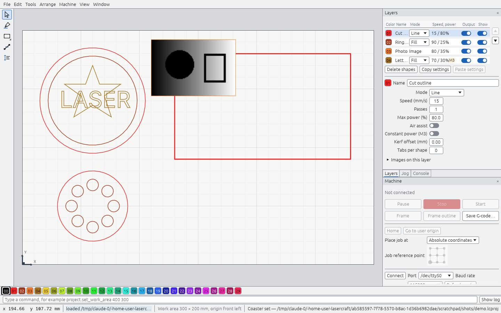
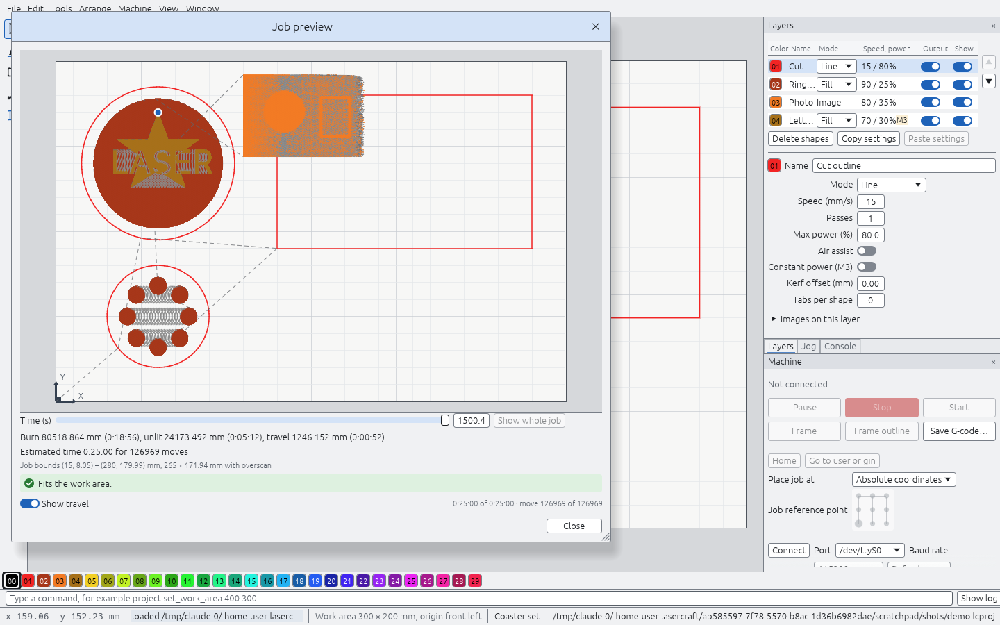
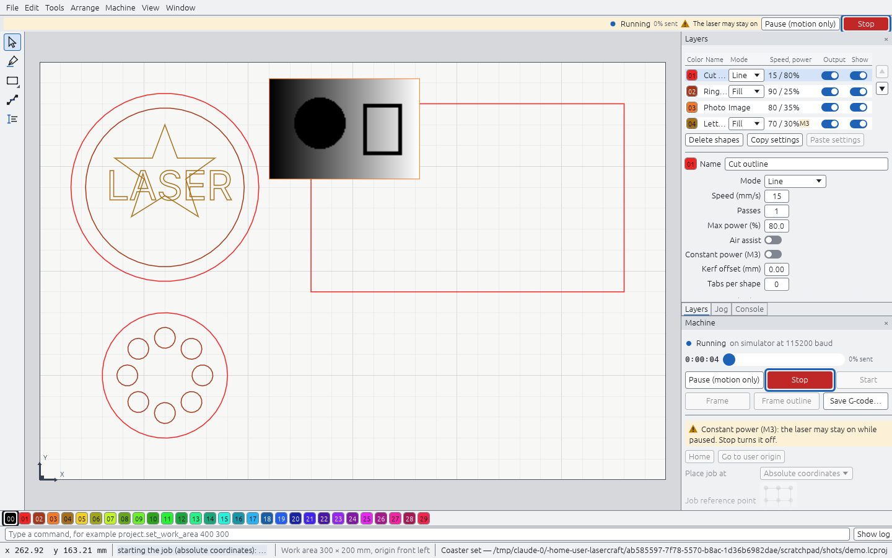
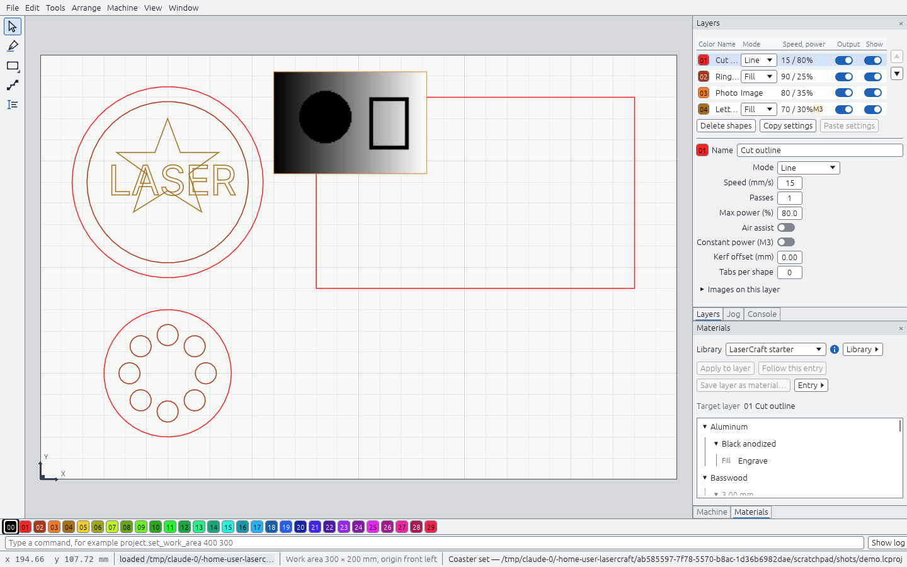
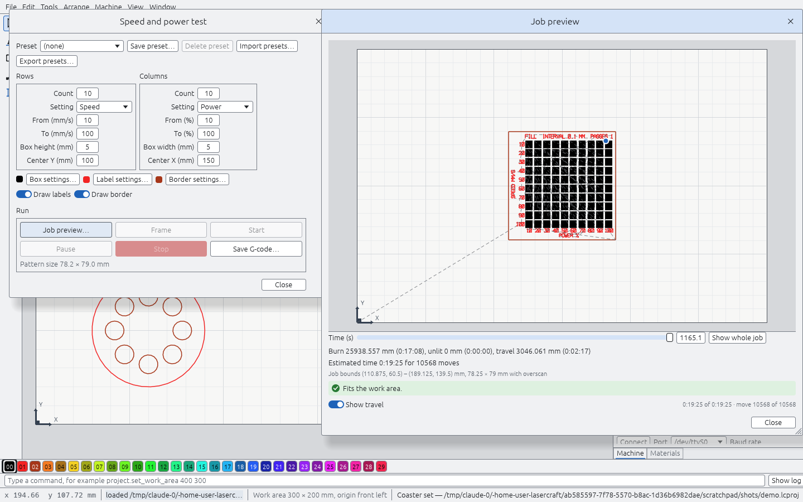
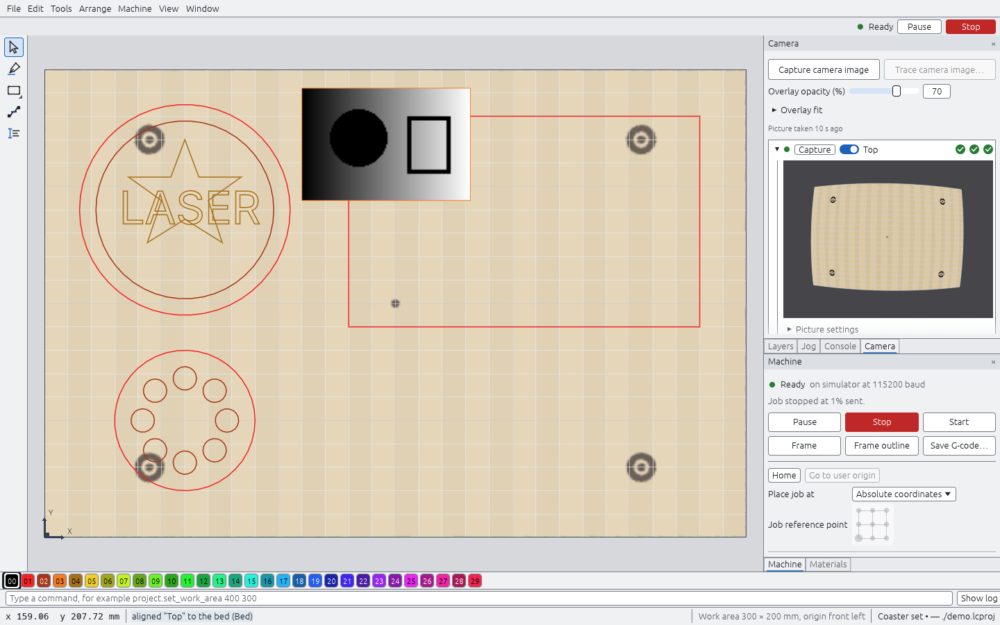

# LaserCraft

A clean-room, pure-Rust app for designing and running jobs on laser cutters and
engravers, for Linux, Windows and macOS. Its workflow and default shortcuts aim
to feel familiar to people coming from LightBurn. It is an independent project,
not affiliated with or endorsed by LightBurn Software.

**Status: milestones M0–M10.** Draw shapes or import SVG and DXF; add text
from system fonts; edit nodes; combine shapes with booleans, weld and offset;
group, align, distribute and array them; put them on color layers with line
or fill settings, kerf and tabs; preview the planned job with travel moves
and a time estimate; engrave PNG and JPEG images with grayscale,
threshold, error-diffusion, ordered or halftone dithering; export verified
GRBL G-code; and run jobs on GRBL lasers
over USB serial: connect, home, jog, frame with the laser off, start, pause
and stop, place the job at the head or a user origin, and use the console.
Keep device profiles for each machine (work area, port, power and speed
limits), store layer settings in material libraries (a starter library of
our own conservative values is built in), and run speed and power or line
interval test patterns to find settings for a new material.
Engrave round objects on a roller or chuck rotary, correct for tapered
cups, and cut printed sheets with print registration. Put a USB or network
camera above the bed or on the laser head: correct its lens, align it by
burning and finding four marks, scan the bed with a head camera, and place
designs on the live camera picture. Trace images and camera pictures into
vector shapes.
Every device feature is tested against a simulated GRBL controller, which
the app also offers as a port. Everything works headlessly from the CLI.
See the milestone list in `CLAUDE.md`.

## Screenshots

The main window: drawing tools on the left, the canvas with the bed, the
Layers panel (upper dock group, with Jog and Console tabs) and the Machine
panel (lower group) on the right, the numbered palette strip, the command
line and the status bar.



The job preview (Alt+P): burn moves in layer colors, travel dashed, the
simulated head, the time slider, the job summary and the bounds check.



Running a job on the built-in GRBL simulator. While a machine is connected
the job bar at the top right always shows the machine state, the sent share,
Pause and Stop; this job uses constant power (M3), so Pause reads "Pause
(motion only)" with a warning.



The Materials panel (lower dock group, second tab): material libraries
as a tree by material and thickness; apply an entry to the edited layer or
make the layer follow it.



The Speed and power test (Machine menu) with its job preview: a grid of
boxes from least to most energy, with labels and a border.



The Camera panel and the camera overlay: after correcting the lens and
burning and finding the four alignment marks, the camera picture lies on
the bed under the design. Here the simulated camera sees what the
simulated laser burned.



The screenshots show `examples/screenshot-demo.lcs`.

## Install

Releases carry four packages (`docs/spec/release.md`):

- Linux: `LaserCraft-<version>-x86_64.AppImage` (make it executable and
  run it) or `LaserCraft-<version>-x86_64.flatpak`
  (`flatpak install --user LaserCraft-<version>-x86_64.flatpak`; it asks
  for device access so it can reach the laser's serial port).
- Windows: `LaserCraft-<version>-x86_64.msi`.
- macOS: `LaserCraft-<version>-universal.dmg` (Apple silicon and Intel;
  not notarized yet, so open it with right-click → Open the first time).

## Build and run

```sh
cargo build --release
target/release/lasercraft [project.lcproj]
target/release/lasercraft-cli help
target/release/lasercraft-cli script examples/m3-design.lcs
target/release/lasercraft-cli script examples/m7-images.lcs
target/release/lasercraft-cli --config /tmp/lc script examples/m8-materials.lcs
target/release/lasercraft-cli pattern speed_power --svg grid.svg --gcode grid.gcode
target/release/lasercraft-cli preview job.lcproj --svg toolpath.svg
target/release/lasercraft-cli export job.lcproj job.gcode --s-max 1000
target/release/lasercraft-cli simulate job.lcproj device.home "device.frame" \
    "device.start from=current anchor=center"
```

On Linux the window needs `libxkbcommon-x11` and an OpenGL driver at runtime;
desktop installs normally have both. Serial access for controllers is covered
in `docs/linux-serial.md`.

## Documents

- `CLAUDE.md`: rules, quality gates, milestones.
- `ARCHITECTURE.md`: crates, threading, dependencies.
- `docs/clean-room.md`: provenance rules.
- `docs/spec/`: behavior specs, each with its sources.
- `docs/hardware-testing.md`: manual checks on real machines.
- `docs/parity.md`: what LaserCraft covers of the reference's public
  documentation, page by page (`cargo xtask parity`).
- `packaging/`: release packaging (`docs/spec/release.md`).

## License

GPL-3.0-or-later (`LICENSE`).
